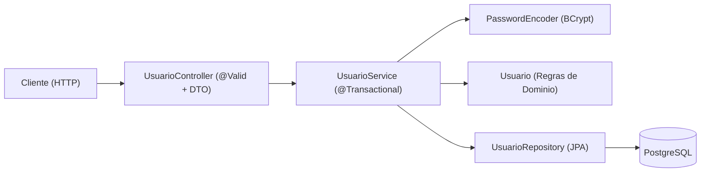
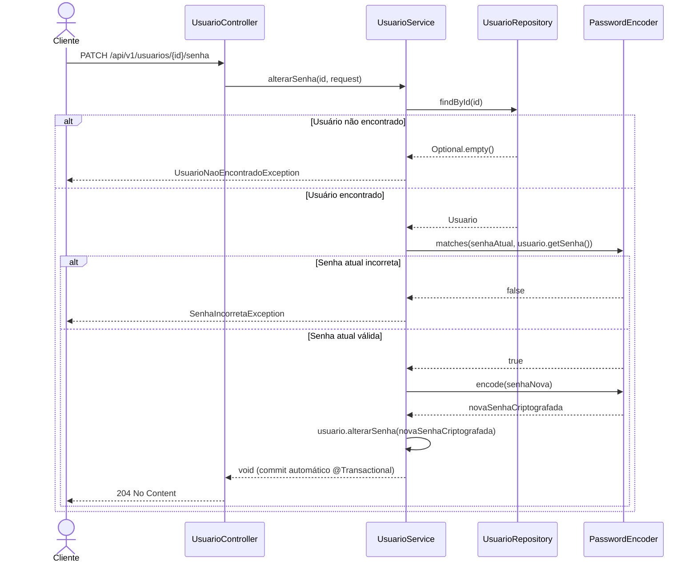

# Login System API

API REST desenvolvida em **Java com Spring Boot** para prática e aprofundamento nos estudos de desenvolvimento backend, autenticação, segurança e boas práticas de arquitetura.

## Tecnologias Utilizadas

- **Java 21**
- **Spring Boot** (WebMVC, Data JPA, Security, Validation)
- **PostgreSQL**
- **Lombok**
- **Maven**

## Funcionalidades Implementadas

- Cadastro de usuários com criptografia de senha (`BCryptPasswordEncoder`)
- Atualização completa de dados cadastrais (`PUT`)
- Atualização parcial de dados cadastrais (`PATCH`)
- Alteração de senha com validação da senha atual
- Ativação e desativação de usuários
- Validação de entrada com Jakarta Validation (`@Valid`) e DTOs em `record`
- Exceções personalizadas de domínio (`UsuarioNaoEncontradoException`, `SenhaIncorretaException`)

## Endpoints

Base URL: `/api/v1/usuarios`

| Método | Rota | Descrição |
| :--- | :--- | :--- |
| `POST` | `/api/v1/usuarios` | Registra um novo usuário |
| `PUT` | `/api/v1/usuarios/{id}/atualizar` | Atualiza todos os dados cadastrais do usuário |
| `PATCH` | `/api/v1/usuarios/{id}` | Atualiza parcialmente os dados do usuário |
| `PATCH` | `/api/v1/usuarios/{id}/senha` | Altera a senha do usuário |
| `PATCH` | `/api/v1/usuarios/{id}/ativar` | Ativa o usuário |
| `PATCH` | `/api/v1/usuarios/{id}/desativar` | Desativa o usuário |

## Como Executar o Projeto

### Pré-requisitos
- Java 21 instalado
- PostgreSQL em execução

### 1. Configurar variáveis de ambiente
Crie um arquivo `.env` na raiz do projeto com base no `.env_example`:

```env
URL_DB=jdbc:postgresql://localhost:5432/nome_do_banco
USERNAME_DB=seu_usuario
PASSWORD_DB=sua_senha
```

Carregue as variáveis no terminal (Linux/macOS):

```bash
set -a && source .env && set +a
```

### 2. Rodar a aplicação

```bash
./mvnw spring-boot:run
```

## Fluxo da Aplicação

### Arquitetura e Fluxo Geral de uma Requisição



### Fluxo de Alteração de Senha (`PATCH /api/v1/usuarios/{id}/senha`)



## Estrutura do Projeto

```text
src/main/java/br/com/victorzendem/login/
├── controller/   # Endpoints REST
├── dto/          # Records de entrada (Request) e saída (Response)
├── enums/        # StatusUsuario e TipoUsuario
├── exceptions/   # Exceções personalizadas
├── model/        # Entidades JPA
├── repository/   # Interfaces Spring Data JPA
├── security/     # Configurações de segurança e PasswordEncoder
└── service/      # Regras de negócio
```
